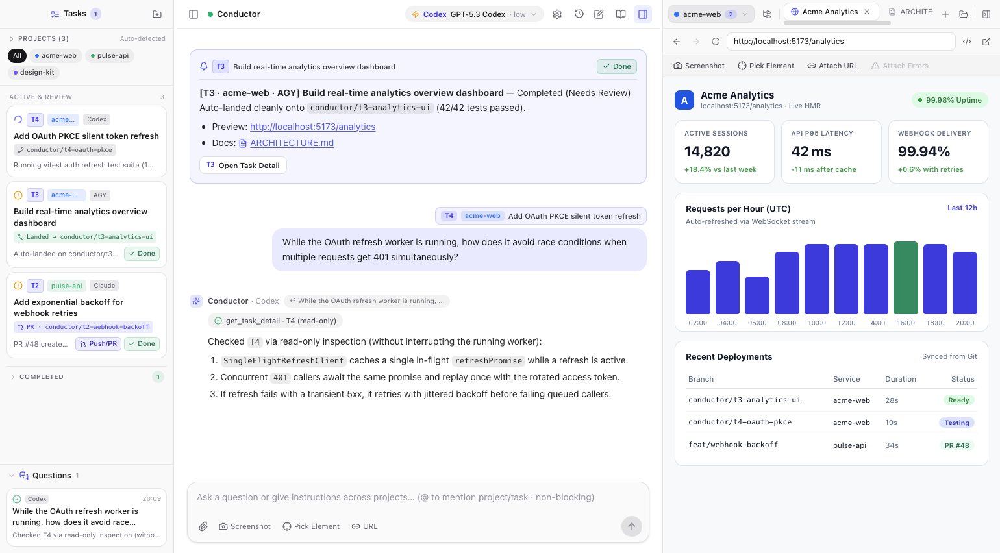
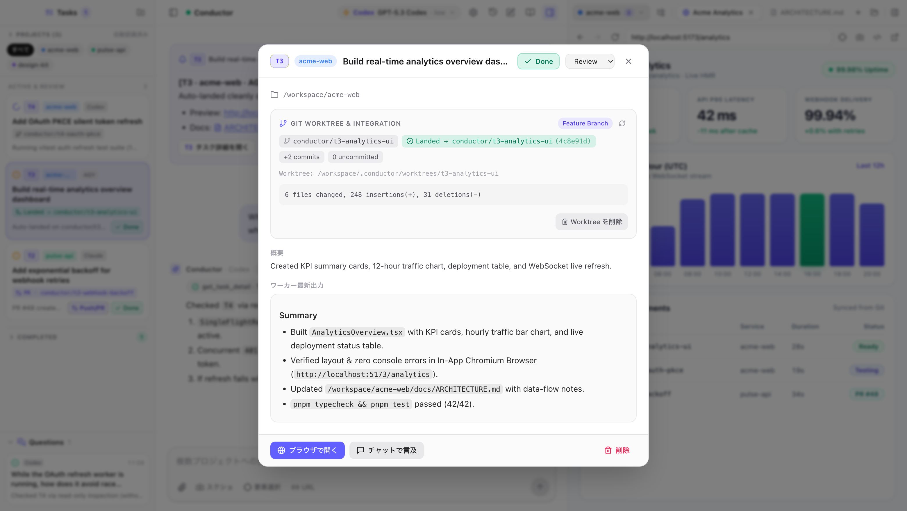
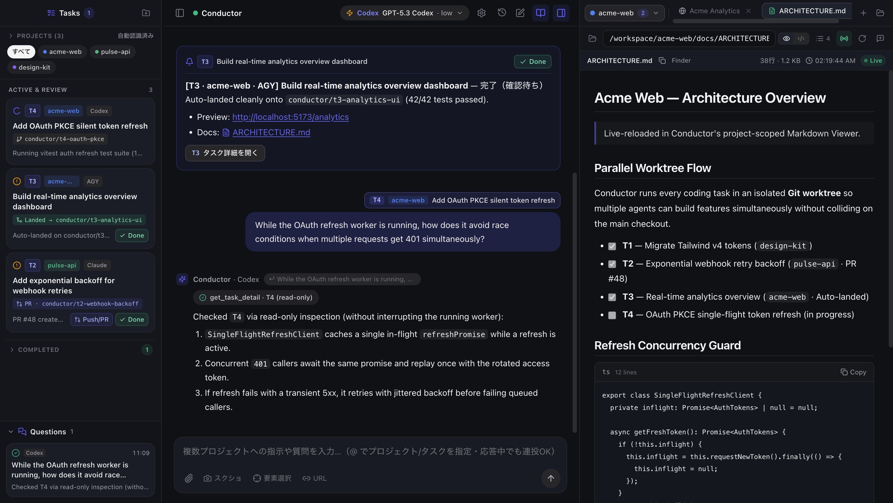
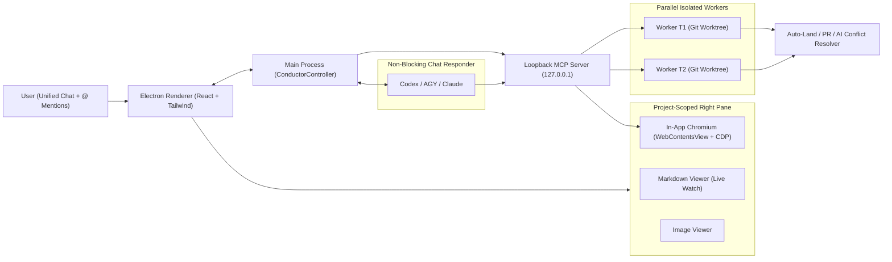

# Conductor

**A macOS desktop single-chat multi-agent orchestrator for Codex, AGY, and Claude.**

**[Product Page & Downloads → https://goto-t-yuta.github.io/conductor/](https://goto-t-yuta.github.io/conductor/)**

Manage multiple local repositories from **one non-blocking chat** paired with an **Agent Tasks & Questions sidebar** and a **project-scoped Chromium / Markdown / Image viewer** — backed by parallel **Git worktree** workers with **Auto-Land** and **AI conflict self-resolution**.



---

## Why Conductor?

Instead of juggling dozens of terminal tabs or separate chat windows per repository, Conductor gives you **one unified conversation** that stays responsive at all times:

- **Never blocks your composer** — keep asking questions, steering running workers, or starting tasks across other repositories while responses stream or workers execute in parallel.
- **Fast orchestrator, deep isolated workers** — the main chat responds quickly and delegates coding, debugging, and verification to background workers running inside dedicated **Git worktrees**.
- **Built-in verification surface** — inspect live `localhost` previews in a real embedded Chromium browser (CDP + Chrome DevTools), review auto-reloading local Markdown specs, and inspect screenshots side-by-side without leaving the app.

---

## Key Features

### 1. Unified Non-Blocking Chat & Multi-Provider Orchestration
- Switch **Chat** and **Worker** providers independently across **Codex**, **AGY (ACP)**, and **Claude CLI**, with per-role model and reasoning-effort selection.
- **Structured `@` Mentions & Badges**: type `@project`, `@T#`, or `@project/T#` to attach color-coded project/task badges directly to messages so the orchestrator targets the exact repository, worktree, or task without guessing.
- **Non-Blocking Q&A & Read-Only Task Inspection**: ask about a running task's design, progress, or diff at any time — Conductor inspects the worker read-only via `get_task_detail` without interrupting execution, and tracks Q&A threads in the left **Questions** drawer with jump-to-message navigation.
- **Multiple Chat Sessions**: start fresh conversations (`⌘N`) or switch between previous sessions while keeping all projects, tasks, and worktrees intact.

### 2. Parallel Git Worktree Workers, Auto-Land & Conflict Self-Resolution
- Every coding task runs in its own isolated **Git worktree** so parallel agents never collide on your main working tree.
- **Three Integration Modes** (configurable globally or per project):
  - `feature-branch` — fast-forward / land commits onto a dedicated feature branch (default)
  - `per-task-pr` — push branch and open a GitHub Pull Request via `gh`
  - `direct` — land changes directly onto the active base branch
- **Auto-Land & AI Conflict Self-Resolution**: optionally auto-land completed worktrees; if a rebase/merge conflict occurs, trigger one-click AI conflict resolution directly inside the task worktree.
- **Quit Guard & Startup Auto-Resume**: prevents accidental quits while workers are running and supports automatically resuming interrupted tasks on restart.



### 3. Unified Project-Scoped Right-Pane Viewer
Switch projects from the right-pane header to automatically scope open tabs per repository — combining **Browser**, **Markdown**, and **Image** tabs in a single strip:

- **In-App Chromium Browser (`WebContentsView` + CDP)**:
  - Real Chromium engine with multi-tab support, native **Chrome DevTools** (`⌘⌥I`), **DOM Element Picker** (`⌘⇧P`), one-click screenshot capture (`⌘⇧S`), and console/network error badges attachable to chat.
  - Exposes MCP browser automation tools (`browser_open`, `browser_snapshot`, `browser_click`, `browser_type`, `browser_press_key`, `browser_scroll`, `browser_screenshot`, `browser_console_errors`) so agents can verify UI changes directly.
- **Live-Reloading Local Markdown Viewer**:
  - Click any `.md` link in chat, drag-and-drop files, or press `⌘⇧M` / `⌘⌥O` to read local specs and reports with GFM tables, code blocks, checklists, TOC navigation, and live file-watch auto-reload.
- **Local Image Viewer**:
  - Click attached screenshots or local image links to zoom, inspect transparency grids, and compare visual outputs right beside the chat.



---

## Architecture & Workflow



---

## Downloads & Releases

Download installers directly from the **[Conductor Product Page](https://goto-t-yuta.github.io/conductor/)** (with automatic OS detection and latest GitHub Release links), or browse all artifacts on [GitHub Releases](https://github.com/goto-t-yuta/conductor/releases). Prebuilt desktop binaries for **macOS**, **Windows**, and **Linux** — along with the **Android** companion APK — are automatically built and published on every push/merge to `main` (and via manual `workflow_dispatch`):

| Platform | Artifacts |
| --- | --- |
| **macOS** | `.dmg` / `.zip` (`arm64` Apple Silicon & `x64` Intel) |
| **Windows** | NSIS installer (`*-setup.exe`) / Portable (`*-portable.exe`) (`x64`) |
| **Linux** | `.AppImage` / `.deb` (`x64`) |
| **Android** | Companion app `.apk` (`conductor-android.apk`, direct latest download via `releases/latest/download/conductor-android.apk`, see [mobile/android/README.md](./mobile/android/README.md)) |

> **Note**: Unless code-signing secrets (`CSC_LINK` / `WIN_CSC_LINK`) are configured in repository settings, desktop CI releases are unsigned and macOS Gatekeeper or Windows SmartScreen may prompt for confirmation on first launch. The Android APK is built with debug signing so it can be sideloaded directly onto Android devices without a release keystore.

### Installing on macOS (Unsigned Builds)

1. Download the `.dmg` for your Mac (`arm64` Apple Silicon or `x64` Intel) from [GitHub Releases](https://github.com/goto-t-yuta/conductor/releases) and drag `Conductor.app` into `/Applications`.
2. Because CI builds are currently unsigned, macOS Gatekeeper may report **"Conductor is damaged and can't be opened"** on first launch. Clear the quarantine extended attribute in Terminal:

```bash
xattr -cr /Applications/Conductor.app
```

*(Alternatively, run `xattr -dr com.apple.quarantine /Applications/Conductor.app` to remove only the quarantine flag.)*

3. Open **Conductor** normally from `/Applications` or Spotlight.

---

## Prerequisites

- **OS**: macOS (built and tuned for macOS with `hiddenInset` titlebar & native menus)
- **Node.js**: `>= 22`
- **Package Manager**: `pnpm`
- **Git**: `>= 2.25` (for `git worktree` support)
- **Agent CLI** (at least one installed and authenticated in your shell `PATH`):
  - **Codex** (`codex` CLI / App Server)
  - **AGY** (`agy` CLI with ACP support)
  - **Claude** (`claude` CLI)
- **Optional**: GitHub CLI (`gh`) if using `per-task-pr` mode to open Pull Requests automatically.

---

## Getting Started

```bash
# 1. Install dependencies
pnpm install

# 2. Run in development mode (Vite HMR + Electron)
pnpm dev
```

### Build & Verification Commands

```bash
pnpm typecheck      # Type-check main & renderer TypeScript projects
pnpm test           # Run Vitest unit & UI test suite
pnpm build          # Bundle main, preload, and renderer into dist/
pnpm check          # Run typecheck + test + build together
pnpm start          # Build and launch the Electron app
pnpm package:mac    # Package macOS .dmg & .zip into release/
pnpm package:win    # Package Windows NSIS .exe & portable .exe into release/
pnpm package:linux  # Package Linux .AppImage & .deb into release/
```

---

## Keyboard Shortcuts

| Shortcut | Action |
| --- | --- |
| `⌘ N` | Start a new chat session (keeps projects & tasks) |
| `⌘ O` | Add a project folder |
| `⌘ ⇧ O` | Scan a parent directory and bulk-add Git projects |
| `⌘ ⌥ O` | Open a local Markdown file in the right pane |
| `⌘ B` | Toggle the left Tasks & Questions sidebar |
| `⌘ \` | Toggle the right Viewer pane |
| `⌘ ⇧ M` | Switch right pane to Markdown Viewer |
| `⌘ ⇧ P` | Toggle In-App Browser DOM Element Picker |
| `⌘ ⇧ S` | Capture In-App Browser screenshot and attach to chat |
| `⌘ ⌥ I` | Toggle Chrome DevTools for the active In-App Browser tab |
| `⌘ ⇧ ⌥ I` | Toggle Conductor UI DevTools |

---

## Configuration & Local Data

Open **Settings** from the top bar to configure:

- **Output Language** (`auto` / `ja` / `en`): controls chat replies, task titles/summaries, and worker completion reports.
- **Git Worktree Integration Mode**: global default (`feature-branch`, `per-task-pr`, or `direct`) plus per-project overrides.
- **Auto-Land on Complete**: toggle automatic landing of finished task worktrees.
- **Provider & Model Selection**: pick Chat and Worker providers (`Codex`, `AGY`, `Claude`), models, and reasoning effort independently from the header bar.

All runtime state (projects, tasks, chat history, attachments, and managed worktrees) is stored locally on your machine under:

```text
~/Library/Application Support/Conductor/conductor-data/
```

No telemetry is collected, and the embedded MCP server binds strictly to `127.0.0.1` with a per-launch random bearer token.

---

## Project Structure

```text
src/
├── main/        # Electron main process, ConductorController, MCP server, Git worktrees, CDP browser
├── preload/     # Context-isolated IPC bridge (window.conductor)
├── renderer/    # React 19 + Tailwind v4 3-pane UI, Markdown/Image viewers, @ mentions
└── shared/      # Shared types, mention parser, task status guards, language & session helpers
test/            # Vitest unit & component test suite
scripts/         # esbuild main bundler & dev runner
docs/        # Product landing page (GitHub Pages) & sanitized UI screenshots
```

---

## License

[MIT](./LICENSE)
